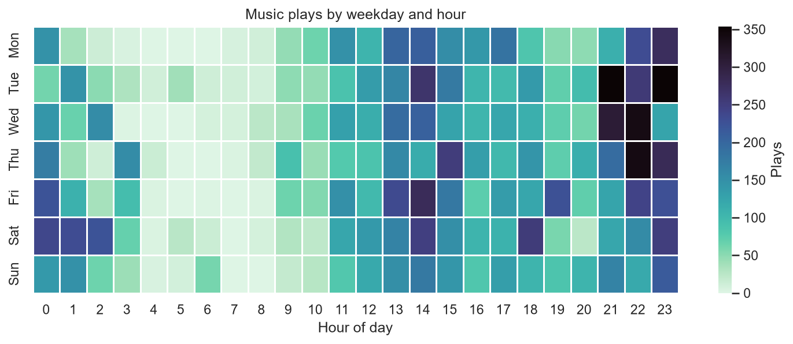
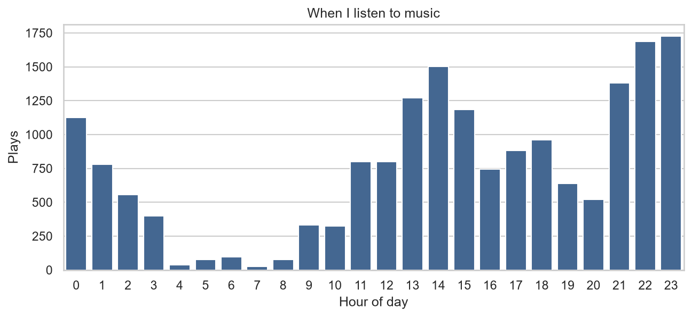
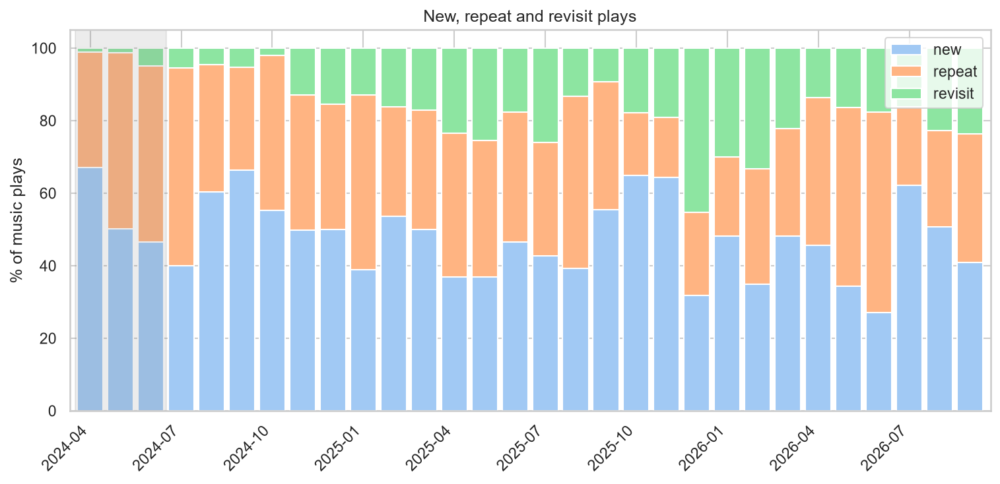
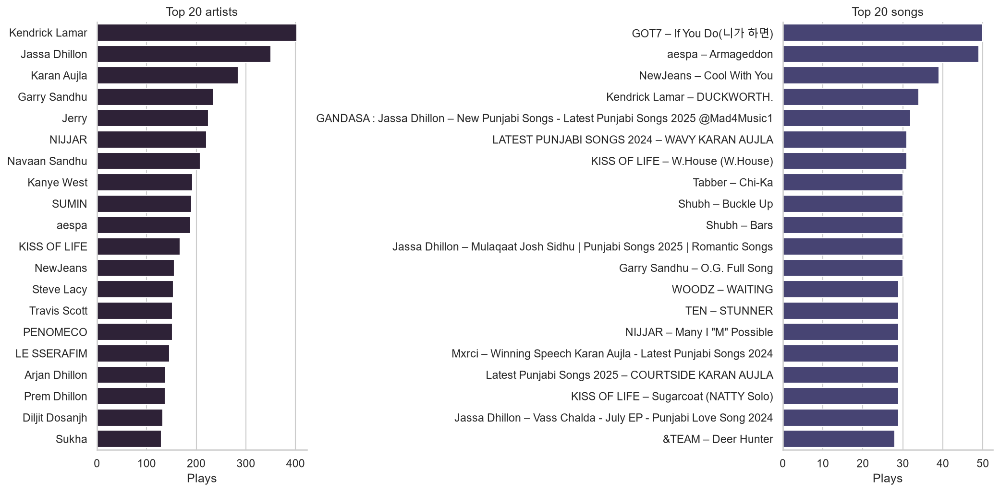
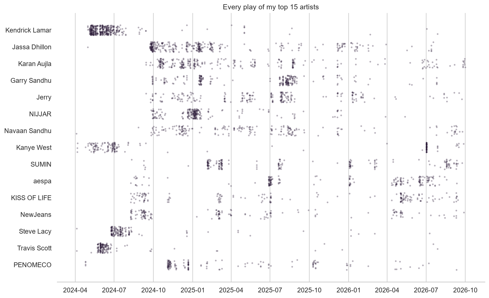
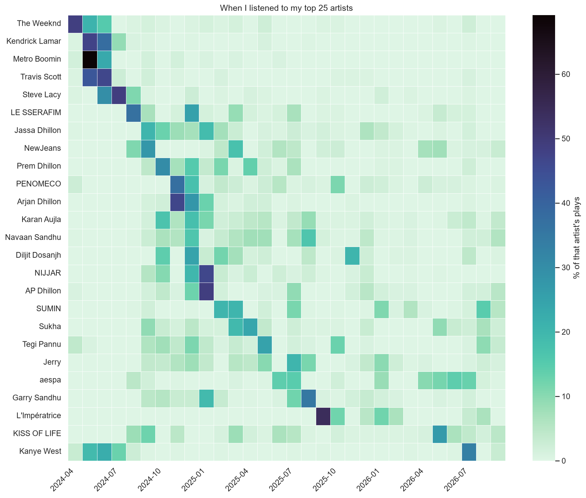

# Analysis of My Music Listening Patterns Through YouTube History

A Spotify Wrapped inspired analysis of my own listening, built from scratch from my YouTube watch history: 75,000+ plays over two and a half years, cleaned, enriched through the YouTube Data API, stored in SQLite and analysed with SQL and Python.

Similar to how Spotify Wrapped may give you your top artists and songs of the year, I wanted to go one step further and extract this information to see how my taste changed long-term, identify any phases which had a drasticly different pattern, and analyse my general activity day to day.

**Highlights**
- An end-to-end, re-runnable pipeline: raw JSON export - YouTube Data API enrichment - SQLite database - SQL analysis - charts
- A rule-based music classifier that separates songs from everything else I watch, validated on hand-checked samples
- A title parser that extracts artist and song from messy video titles. It resolves the artist for roughly **97% of song plays**
- Analysis of when I listen, how often I return to music, my top artists and songs, and which artists were a short phase or a long-term favourite

**Tools:** Python (pandas, matplotlib, seaborn), SQL, YouTube Data API v3

---

## The questions

1. **When** do I listen to music (hour of day, day of week, month)?
2. How much of my listening is **new** music, **repeats**, or **revisits** of old favourites?
3. Who are my **top artists and songs**, overall and month by month?
4. Which artists were a **phase** and which are long-term **staples**?

## Data and privacy

The data is my own **Google My Activity** export (YouTube, JSON format), June 2023 to September 2026. The analysis window is **April 2024 to September 2026** (30 full months), because music on this account only really starts in April of 2024.

**The raw data, database and notebooks are deliberately not in this repository**, because they contain my personal watch history and exploratory analysis which includes watched video titles from my history. Only the code and the database schema are published. The pipeline runs on anyone's own export (see [How to run it](#how-to-run-it-on-your-own-data)).

---

## Pipeline

```
MyActivity.json
  → src/clean.py            keep "Watched" entries, parse timestamps, extract video IDs   → watched.parquet
  → src/enrich_youtube.py   YouTube Data API: title, channel, category, duration, topics   → video_meta.jsonl
  → src/build_dataset.py    merge, convert to UK local time, label each video's music tier → plays_enriched.parquet
  → src/load_db.py          load into SQLite (videos, plays, music_plays view)            → db/music.db
  → src/extract_artists.py  artist and song for every music video                         → video_artists table
  → notebooks (SQL + seaborn)                                                              → reports/figures/
```

Design principles:
- **Raw data is never edited.** Everything downstream is generated by scripts and can be rebuilt.
- **Categorise instead of deleting.** Entries are labelled (e.g. `music_tier`, `confidence`) and filtering happens in SQL views.
- **The API step is resumable.** Results are cached after every batch of 50 videos, so a crash loses nothing. The full run made about 1,230 requests, well within the free daily quota.

The database has two normalised tables (`videos`, `plays`) plus `video_artists`. Two views define the analysis in one place: `music_plays` (music only, inside the window) and `song_plays` (music plays with an artist attached). See [`sql/schema.sql`](sql/schema.sql).

---

## Method

### 1. What counts as "music"?

YouTube doesn't label songs, so I combined three imperfect signals:

| Signal | What it is | Weakness |
|---|---|---|
| "Artist - Topic" channel | YouTube's auto-generated music channels | Only covers a fraction of my music |
| Category 10 ("Music") | Chosen by the uploader | Noisy: includes non-music |
| Music topic | Wikipedia topic assigned by YouTube | Often missing for Topic tracks and is noisy |

I combined these with a duration filter: under 1 minute is a clip or Short, and over 8 minutes is usually a mix or album. Each video is put into one of several **tiers**: `music`, `maybe_music`, `long_form`, `too_short`, `unavailable`, `not_music`.

I chose the rules by looking at the data. For example, 72% of 3 to 10 minute videos had a music topic, compared with 6% of 10 to 30 minute ones. I then checked them on hand-labelled random samples: **40/40** of the `music` tier and about **80%** of the `maybe_music` tier were genuine songs. The main analysis uses the `music` tier only.

### 2. Who is the artist? Parsing messy titles

Most of my music comes from official videos, label channels and fan uploads, not Topic channels. That means the artist has to be extracted from titles like:

```
Artist - Songname (Official Music Video)
Artist 1 x Artist 2 Ft. Artist 3 - Songname [Official MV/SONG/VIDEO]
Artist 'Songname' MV                      (uploaded by a label channel)
Songname | Artist
```

`src/extract_artists.py` applies the following rules in order, and the first one that works wins:

| # | Rule | Confidence |
|---|---|---|
| 0 | **Exclude** type beats and reaction videos. In a type beat, the artist named is a style reference, not the performer | – |
| 1 | **Topic channel:** artist = channel name, song = title | high |
| 2 | **Matched:** after stripping clutter like "(Official Video)" and splitting on `-`, `\|`, `:`, `x` and `ft.`, part of the title matches the channel name or a **dictionary of known artists** | high |
| 3 | **Quote pattern:** K-pop label uploads in the form `ARTIST 이름 'Song' MV` | high |
| 4 | **Dash guess:** for `A - B` titles where nothing is recognised, the artist is on the left (true in 95% of titles I could verify) | medium |
| 5 | **Pipe guess:** for `A \| B` titles, the artist is on the right | low |
| 6 | **In title:** a known artist's name appears anywhere in the title | low |

The dictionary starts with about 900 artists from Topic channels and **learns from confident matches**, growing to about 1,950 names. That lets it recognise artists who don't have a Topic channel. Names are compared using a normalised key (lowercase, no accents, punctuation or spaces), so `50CentVEVO`, `50 Cent` and `50 cent` all match. Uploads of the same song are merged into one track using an `artist|song` key.

I built the rules iteratively. After each step I measured coverage and read a sample of the titles that were still unresolved to find the next pattern. Coverage went from 43% to 71%, and then to about 97%. That's where I stopped, because the remaining titles were mostly one-off uploads with no consistent structure. After seeing the play counts for the remaining unmatched videos, none exceeded 2 views, so I was happy not including them in the further analysis.

**Validation.** I hand-checked a random sample of 30 videos per confidence level:

| Confidence | Artist correct |
|---|---|
| High | 96.7% |
| Medium | 96.7% |
| Low | 83.3% |
| **Plays-weighted overall** | **95.6%** |


The weighted accuracy was calculated by multiplying each confidence level's accuracy by the number of plays in that confidence level, summing that over all three levels and then dividing by the total number of plays.


---

## Findings

### When I listen


This figure shows the distribution of my music plays over an entire week. The main advantage of analysing your own data is that I can explain the patterns displayed in these figures since I know the exact reasons that have caused them. We see that in terms of music plays, late weekday nights are the busiest, which roughly corresponds to the time that I would start studying and pre-reading my lecture notes for the next day. These study sessions would often run into the early morning resulting in the hours from roughly 4-8 being the quietest due to me being asleep. This can be seen in the figure. 

Another pattern that can be explained is the small peak at 5/6pm, a time where I often take a break from what I am doing to have a cup of tea!

### How much I listen over time


This figure displays the same data as the previous figure, just in another way. This is particularly useful for seeing the number of music plays per hour in a day.

### New, repeat or revisit?



This figure is incredibly interesting as it breaks down my music plays over time into three categories: *new* (first play of that video), a *repeat* (played again within 30 days) or a *revisit* (after more than 30 days).

Initially there are no revisited songs and this is as expected since there can be no songs that were replayed after a month, during the first month of data, so the first few months are mainly full of new songs, and new songs that i have replayed within 30 days. Revisited songs begin to grow as time goes on and peak in January of 2026 with almost half of my total plays being revisited songs for that month. 

Additionally, there is a tendency for a surge of new music to come in once every couple of months, which is accurate to how I listen to music. Something I have observed myself over the last couple of years, which explains this, is that I love finding a small selection of songs which evoke some sort of feeling or emotion, replaying them until that feeling fades, and then finding a new selection of songs, and every once in a while revisiting a selection of songs from a particular month (made possible with the YouTube monthly recaps).


### Top artists and songs


I was on the fence about including figures which show my top artists and songs since that is still personal data but it is a part of the analysis and is very interesting to look at, especially when we analyse who was a phase vs a consistent artist later on.

One of the main motivators to see explore who was a phase and who was consistently listened to was the list of my top artists. Kendrick Lamar came in as my most listened artist over the last 2.5 years, and despite this being half expected, it still surprised me because it feels like I haven't listened to a single song of his for around 2 years. By inspecting my top songs, the data confirms that I listen to a broad range of music in terms of genre and geographic location. My top 20 songs include Hip Hop, Garage, R&B, and more.

### Phases vs staples


This figure shows the spread of when I listened to my top 15 artists. Each dot is one play. A dense cluster means a phase; a long, even line means a long-term favourite.

A suspicion that this graph confirmed is that Kendrick Lamar, my most-played artist (403 plays), was indeed a phase. 343 of those 403 plays came in **May–June 2024**, followed by 1 to 5 plays every month since then. Compare this to Karan Aujla, who was consistently listened to from around September 2024 to September 2026, 2 years! 

Once in a while, if I find a song I really like, or I am looking for more songs in a specific style, I will find the artist of that song or songs in that style, and go through their entire discography. I tend to do this with rarer artists, artists who's style I like and I have never heard from before. I did this quite recently but with a more known and familiar artist, Kanye West. We can actually see this on the graph if we look at July 2026. The dark line shows all of the Kanye West plays which took place on that one day.



This figure is similar to the last but instead of the top 15 we are looking at the top 25 and rows are sorted by peak month, so a diagonal "staircase" shows my taste moving from one artist to the next. 

Once again, the data confirms a pattern that I had known. I had a phase where I was predominantly listening to American Hip Hop, and American Rap music, starting in April 2024 and lasting for a couple of months. After that it seems like I began listening to a diverse set of music.


---

## Limitations

- **Plays, not listening time.** The history records when a video starts, not how long it was played or whether it was skipped.
- **Unavailable videos.** 3.8% of plays are deleted or private videos with no information, and they're more common in older data.
- **Classification and parsing are rule-based.** The `maybe_music` tier (about 80% accurate) is excluded, so some fan-uploaded music is missed. About 3% of song plays have no artist, and the low-confidence parsing rules are about 83% accurate.
- **One artist per song.** Only the first-credited artist counts, so features don't get credit.
- **New/repeat/revisit is measured per video, not per song.** Different uploads of the same song count separately.
- **Small validation samples** (30 per level).

---

## How to run it on your own data

1. Create a folder called data, and two folders inside called `raw` and `processed`.
2. Export your history from [Google My Activity](https://myactivity.google.com/): choose YouTube only, JSON format. Save it as `data/raw/MyActivity.json`.
2. Create a YouTube Data API v3 key in Google Cloud Console. Put it in a `.env` file as `YOUTUBE_API_KEY=...`.
3. Create a folder called `db` to store your database.
3. Run:
   ```
   python -m venv myenv
   myenv\Scripts\activate          (Windows; on Mac/Linux: source myenv/bin/activate)
   pip install -r requirements.txt
   python src/clean.py
   python src/enrich_youtube.py
   python src/build_dataset.py
   python src/load_db.py
   python src/extract_artists.py
   ```
4. Then query `db/music.db` from a notebook or DB Browser for SQLite.

## Repository structure

```
src/        pipeline scripts
sql/        schema.sql: tables and views
```

## About this project

This was built with AI assistance (Claude) for writing code. The questions, ideas, rule choices, hand-validation and interpretation are my own.